# SoulScript — Application Flow Specification

**File:** `app_flow.md`  
**Document version:** 1.0  
**Based on:** SoulScript PRD v2.0, `design.md`, and `implementation_plan.md`  
**Audience:** AI coding agent, frontend/backend developers, QA tester

> This document defines how users and system components move through SoulScript. The PRD remains the source of truth for product scope. Use this file to implement navigation, page transitions, API calls, loading/error states, and test scenarios.

---

## 1. Flow conventions

### 1.1 Actors

- **Visitor:** Not authenticated.
- **User:** Authenticated SoulScript account owner.
- **Frontend:** React application.
- **Backend:** FastAPI service.
- **Database:** PostgreSQL.
- **Emotion model:** Pretrained text-classification model invoked through the backend.

### 1.2 Global rules

1. A guest can access only public routes.
2. A user can access only their own entries, predictions, feedback, insights, preferences, and exports.
3. The backend derives the user identity from the authenticated session. The frontend must not decide ownership.
4. Saving an entry and analyzing it are separate operations.
5. AI analysis failure must not invalidate a successfully saved entry.
6. The original AI prediction and the user's correction remain distinct.
7. Theme preference controls theme behavior. A model prediction cannot override Manual or Default mode.
8. Analytics and insights use the authenticated user's data only.
9. All date grouping uses the configured user timezone and a consistent week boundary.
10. Empty and error states are intentional states, not missing UI.

---

## 2. Route and access flow

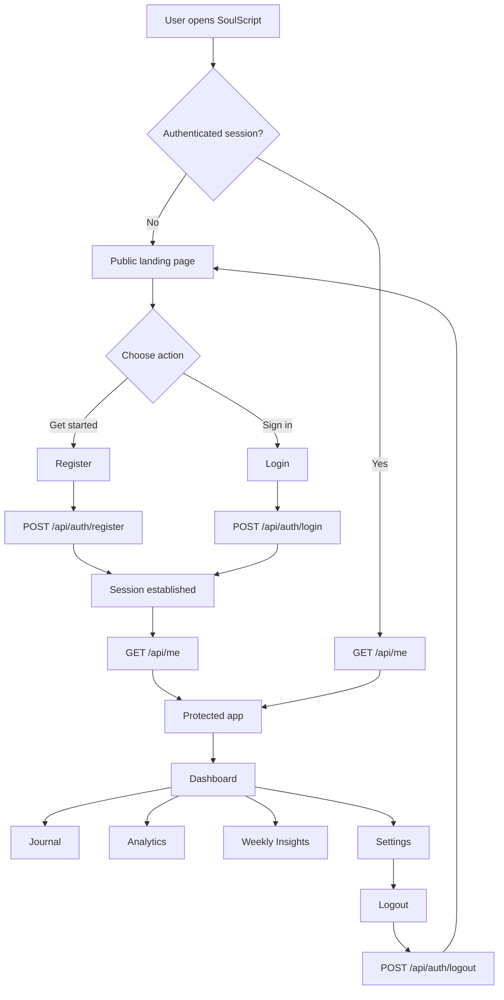

### Route guard rules

| User state | Requested route | Expected behavior |
|---|---|---|
| Guest | `/` | Allow |
| Guest | `/login` | Allow |
| Guest | `/register` | Allow |
| Guest | `/app/*` | Redirect to `/login`, preserving safe return path |
| Authenticated | `/login` | Redirect to `/app/dashboard` |
| Authenticated | `/register` | Redirect to `/app/dashboard` |
| Authenticated | `/app/*` | Allow after session check |
| Expired session | Protected route/API | Clear private state and redirect to `/login` |

Do not briefly render private content before the initial session check finishes.

---

## 3. First-time user flow

### 3.1 Visitor to account

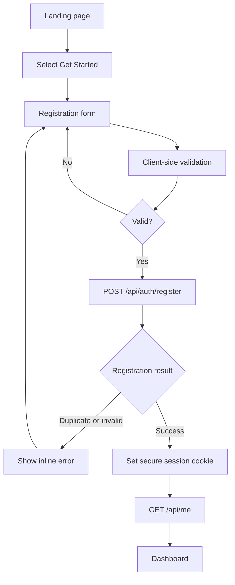

### 3.2 Registration details

UI fields:
- Email.
- Password.
- Confirm password if local auth is used.

Client validation:
- Required fields.
- Valid email shape.
- Password policy.
- Confirmation matches.

Backend validation remains authoritative. Do not rely only on frontend validation.

On success:
- Establish session according to the configured auth strategy.
- Load current user.
- Create default preferences if none exist.
- Determine browser timezone and persist it if the product uses stored timezone.
- Redirect to Dashboard.
- Show first-entry onboarding state.

On failure:
- Keep email field value.
- Do not keep or echo plaintext password after a failed request if the form is reset for security.
- Display safe, actionable message.
- Do not expose whether sensitive internal account details exist beyond the intended duplicate-account handling.

---

## 4. Login and session restoration flow

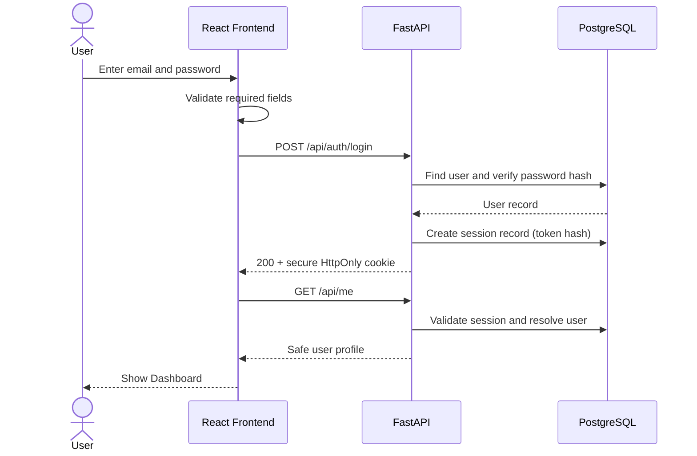

### Refresh behavior

1. App starts.
2. Auth provider enters `checking` state.
3. Frontend calls `GET /api/me` with credentials included.
4. If `200`, set auth state to authenticated.
5. If `401`, set auth state to guest.
6. Render protected or public route accordingly.

### Login error states

- Missing field: local validation.
- Invalid credentials: generic message.
- Rate limited: wait and retry message.
- Network failure: keep form values where safe and allow retry.
- Server unavailable: general retry message.

---

## 5. Dashboard flow

### Initial load

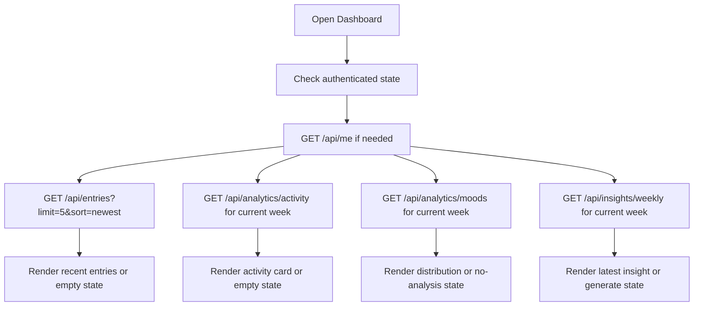

### Dashboard branches

**If there are no entries**
- Show an onboarding panel.
- Explain that the first saved entry will appear here.
- CTA: “Write your first entry.”
- No fake charts or sample counts.

**If entries exist but none are analyzed**
- Show recent entries.
- Show journal activity.
- Show a prompt to analyze an entry.
- Emotion distribution displays a clear “No analyzed entries yet” state.

**If some entries are analyzed**
- Render charts using actual backend aggregates.
- Clearly label the period and counting method.
- Render the latest weekly insight if one exists.

### Dashboard actions

| User action | Destination or action |
|---|---|
| Write an entry | `/app/entries/new` |
| Open recent entry | `/app/entries/:entryId` |
| View all entries | `/app/journal` |
| View analytics | `/app/analytics` |
| View weekly insight | `/app/insights` |

---

## 6. Journal creation flow

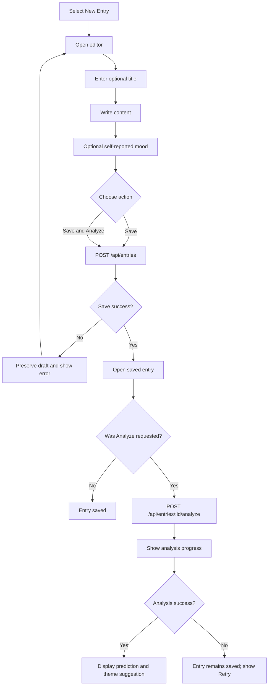

### Editor state model

- `clean`: no edits since opening.
- `dirty`: user has changed fields.
- `saving`: create/update request pending.
- `saved`: server confirmed the write.
- `save_error`: request failed; content retained.
- `analyzing`: inference request pending.
- `analysis_ready`: result received.
- `analysis_error`: inference failed; entry remains saved.
- `analysis_stale`: entry text changed after the stored analysis.

### Save rules

- Required content cannot be blank after trimming for validation.
- Preserve paragraph breaks.
- Enforce backend text-length limits.
- Do not clear the editor before the backend confirms success.
- Prevent accidental duplicate submissions while request is pending.
- If user navigates away with unsaved changes, show a confirmation or preserve a local draft according to implementation.

### Save-and-analyze sequence

1. Save entry.
2. Receive entry ID.
3. Call analyze endpoint.
4. Show progress in the analysis area.
5. Render actual response.
6. On model failure, leave saved content accessible and show retry.

---

## 7. Entry detail, edit, and delete flow

### 7.1 Open entry

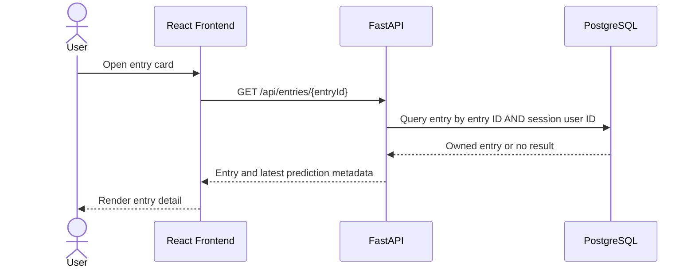

If the user does not own the entry, return the agreed not-found/forbidden response without revealing another user's data.

### 7.2 Edit entry

1. User selects Edit.
2. UI enters edit mode.
3. Current values populate the form.
4. User changes title, content, or self-reported mood.
5. User saves.
6. Frontend calls `PATCH /api/entries/{entryId}`.
7. Backend verifies ownership and validates fields.
8. Backend saves changes and updates timestamp/content version.
9. If content changed, old prediction becomes stale.
10. UI shows success and “Re-analyze” action.

A title-only or self-reported-mood-only edit does not necessarily make text inference stale. Only changes to analyzed content should invalidate the text prediction.

### 7.3 Delete entry

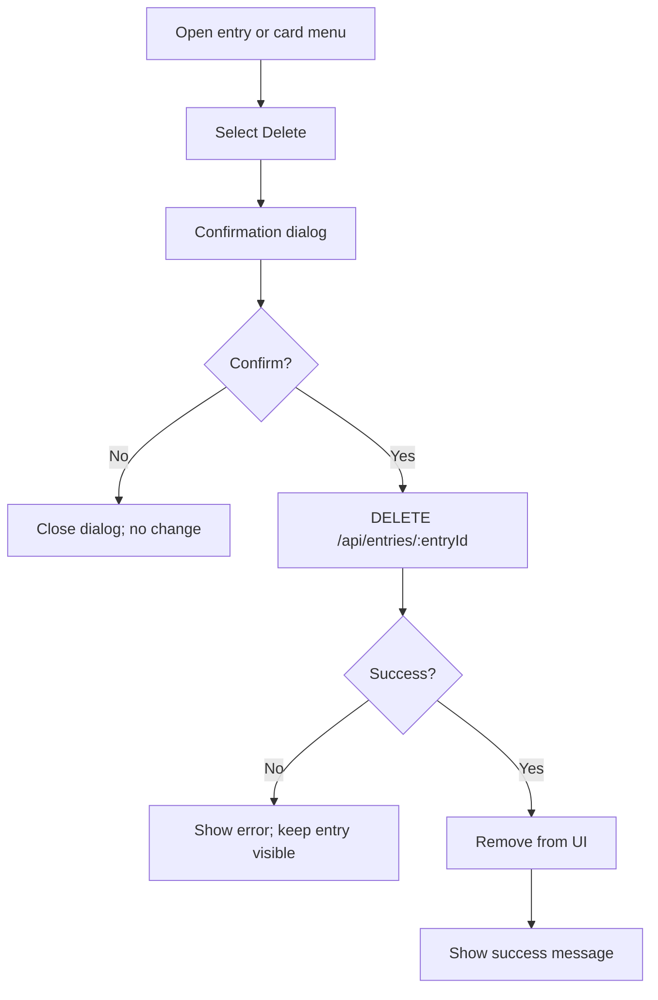

Delete dialog must explain that associated prediction and feedback records are also removed under the app's data policy. If weekly insight content used this entry, mark that summary stale.

---

## 8. Emotion analysis flow

### 8.1 Sequence

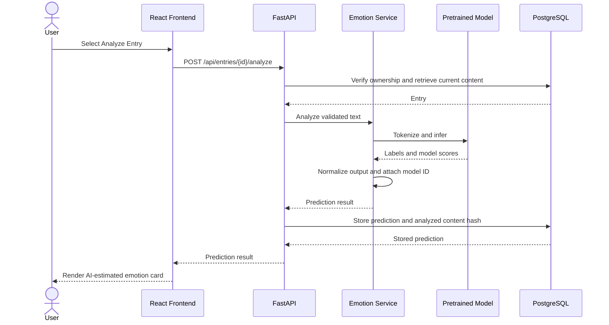

### 8.2 Success behavior

Display:
- “AI-estimated emotions.”
- Dominant label.
- Other selected labels/scores if useful.
- Analysis time.
- Explanatory note.
- Theme suggestion if relevant.
- Action to add user's own report.

### 8.3 Failure behavior

Failure cases:
- Model not downloaded/loaded.
- Inference provider unavailable.
- Entry text too long.
- Unsupported or empty text.
- Rate limit.
- Backend timeout.

Expected behavior:
- Entry is not deleted or modified.
- UI explains only that analysis failed.
- Retry is available where appropriate.
- Backend logs safe error metadata, not full journal content.
- Do not display fabricated fallback labels.

### 8.4 Stale analysis

A prediction is stale if the entry content hash/version no longer matches the analyzed content.

UI:
- Badge: “Analysis from earlier text.”
- Action: “Re-analyze.”
- Do not use stale predictions in current analytics.

---

## 9. Emotion feedback flow

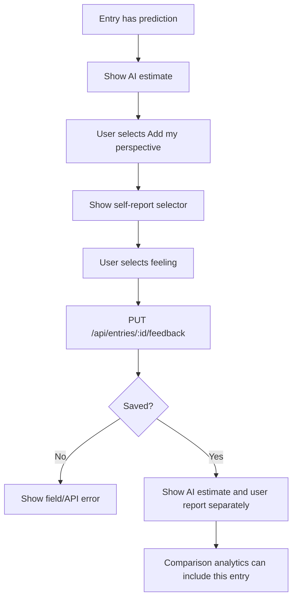

Rules:
- Do not overwrite prediction data.
- Allow user to update their feedback.
- If an entry's self-reported mood was already set during creation, display it separately.
- For comparison analytics use the latest explicit report: feedback if present; otherwise the initial entry self-report.
- Clearly label the comparison as model output versus user report, not an objective measure of emotional truth.

---

## 10. Theme preference flow

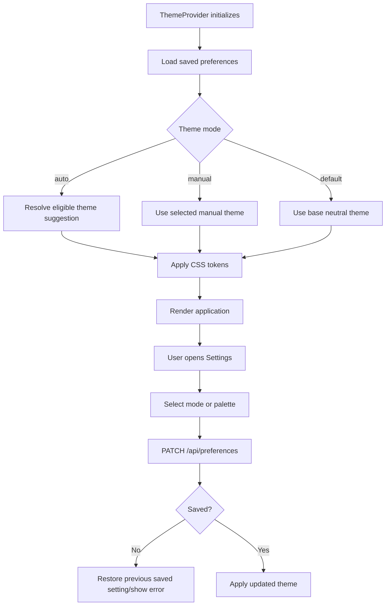

### Theme precedence

1. `manual`: saved selected theme always wins.
2. `default`: base theme always wins.
3. `auto`: use the product's eligible current-entry prediction mapping; fallback to default if none/stale/unsupported.

Do not allow model output to change Manual or Default mode.

---

## 11. Journal history search/filter flow

1. User opens `/app/journal`.
2. Frontend requests first page from `GET /api/entries`.
3. User enters search text or selects date/emotion filters.
4. Frontend debounces text search if appropriate.
5. Frontend resets pagination cursor.
6. Frontend sends filters to backend.
7. Backend applies all filters within the authenticated user's records.
8. Frontend renders cards.
9. User selects “Load more.”
10. Frontend requests next page using cursor.
11. Changing a filter resets to first page.

Empty-state branches:
- No journal entries at all: “Write your first entry.”
- No matching search result: “No entries match these filters” + Clear filters.
- Emotion filter has no match: explain that no analyzed entries match the selected label.

---

## 12. Analytics flow

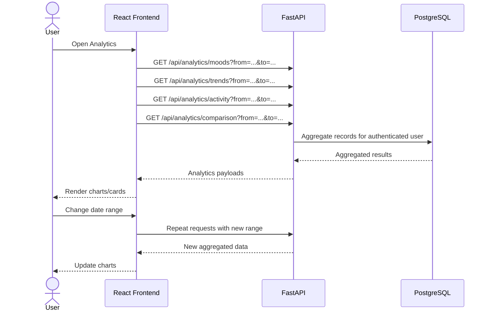

### Analytics rules

- Use latest non-stale prediction per entry.
- Use current user's data only.
- Use the selected date range and configured timezone.
- For comparison, include only entries with both a prediction and user report.
- Always show the comparison denominator.
- Do not label entry counts as emotional intensity.
- Do not imply missing days mean a particular emotion.
- Show empty states when no relevant data exists.

### Chart interaction
- Tooltips show date/category/count.
- Legend items can toggle series only if the chart remains interpretable.
- Charts need text labels and accessible description.
- Clicking an item may navigate to Journal with relevant filters only if that behavior is implemented and safe.

---

## 13. Weekly insight flow

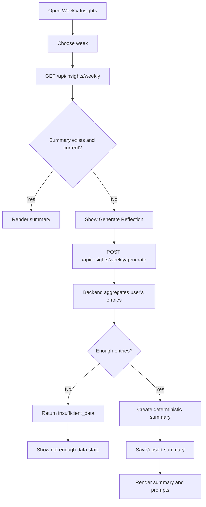

### Weekly date rule

- Week starts Monday.
- Week ends at the next Monday boundary.
- Use the user's configured IANA timezone for date grouping.
- Store timestamps in UTC and use timezone-aware boundaries for queries.
- Display the date range explicitly in the UI.

### Summary content flow

1. Query entries in week.
2. Select latest non-stale prediction per entry.
3. Calculate entry count and emotion counts.
4. Identify recurring terms using the MVP extraction method.
5. Generate cautious template-based summary.
6. Generate one or more neutral reflection prompts.
7. Save summary and supporting entry IDs/fingerprint.
8. Return status.

### Stale summaries

Mark summary stale if a source entry is:
- Created in that week.
- Edited in that week.
- Deleted from that week.
- Re-analyzed or given feedback in a way that affects the summary.

On the next weekly-insight read, either show the stale indicator with regenerate action or regenerate according to the chosen implementation. Do not silently display stale facts as current.

---

## 14. Settings and data-control flows

### 14.1 Update theme preference
Settings → Appearance → choose mode/palette → `PATCH /api/preferences` → apply only after successful response (or optimistic update with rollback) → success message.

### 14.2 Export
Settings → Your Data → Export → `POST /api/export` → backend serializes only current user's data → return JSON file → browser downloads it → show completion.

Export must not include:
- Password hashes.
- Session token or token hashes.
- Secret values.
- Internal infrastructure configuration.

### 14.3 Delete an entry
Covered in Section 7.3. Ensure analytics and weekly summaries are updated or marked stale.

### 14.4 Delete all entries (if included in settings)
Require a separate confirmation from account deletion. Backend operation must delete only current user's entries and dependent predictions/feedback. Mark or remove weekly insights that depended on those entries.

### 14.5 Delete account
Settings → Account danger zone → explain consequence → require re-authentication/confirmation → `DELETE /api/me` → invalidate session → cascade/schedule deletion → clear frontend state → redirect to landing.

### 14.6 Logout
Account menu → Logout → `POST /api/auth/logout` → clear frontend private state → landing/login.

---

## 15. Global error and recovery flows

| Error | Backend behavior | Frontend behavior |
|---|---|---|
| `401` unauthenticated | Return auth error | Clear private state, redirect to login |
| `403` forbidden | Deny request | Show access denied without private data |
| `404` missing/not owned | Return not found | Show not-found page or safe message |
| `409` conflict | Return conflict | Explain and let user resolve |
| `413` content too large | Reject request | Show length limit and preserve editor text |
| `422` validation | Return field errors | Associate errors with controls |
| `429` rate limited | Return retry guidance | Show wait/retry message |
| `500` unexpected | Log safe details with request ID | Generic error plus retry |
| `503` model unavailable | Keep entry intact | Show “entry saved; analysis unavailable” |
| Network timeout | No false success | Preserve form data and allow retry |

Do not retry non-idempotent create requests blindly. For entry creation, consider an idempotency key or carefully handle duplicate submissions.

---

## 16. API-to-screen matrix

| Screen | API calls |
|---|---|
| Registration | `POST /api/auth/register`, then `GET /api/me` |
| Login | `POST /api/auth/login`, then `GET /api/me` |
| Auth bootstrap | `GET /api/me`, `GET /api/preferences` |
| Dashboard | `GET /api/entries`, analytics endpoints, `GET /api/insights/weekly` |
| New Entry | `POST /api/entries`; optionally `POST /api/entries/{id}/analyze` after save |
| Entry Detail | `GET /api/entries/{id}`, `GET /api/entries/{id}/emotions` |
| Entry Edit | `PATCH /api/entries/{id}` |
| Entry Delete | `DELETE /api/entries/{id}` |
| Analyze | `POST /api/entries/{id}/analyze` |
| Emotion feedback | `PUT /api/entries/{id}/feedback` |
| Journal History | `GET /api/entries` with query parameters |
| Analytics | `GET /api/analytics/moods`, `/trends`, `/activity`, `/comparison` |
| Weekly Insights | `GET /api/insights/weekly`, `POST /api/insights/weekly/generate`, `GET /api/insights/history` |
| Settings | `GET /api/preferences`, `PATCH /api/preferences`, `POST /api/export`, `DELETE /api/me` |
| Logout | `POST /api/auth/logout` |

---

## 17. QA scenario checklist

### A. First-time account
- [ ] Guest can view landing.
- [ ] Guest can register.
- [ ] Invalid registration shows useful errors.
- [ ] Duplicate email is handled.
- [ ] Successful registration enters authenticated app.
- [ ] First dashboard shows empty-state CTA.

### B. Authentication
- [ ] Login succeeds for correct credentials.
- [ ] Invalid login shows generic error.
- [ ] Refresh restores valid session.
- [ ] Expired session redirects to login.
- [ ] Logout revokes session.
- [ ] Guest cannot access private API.

### C. Journal
- [ ] Create entry.
- [ ] Empty content rejected.
- [ ] Entry persists after reload.
- [ ] Edit entry.
- [ ] Content change marks prediction stale.
- [ ] Search by text.
- [ ] Filter by date.
- [ ] Filter by emotion.
- [ ] Delete entry with confirmation.

### D. AI
- [ ] Analyze saved entry.
- [ ] Show actual labels/scores.
- [ ] Save model provenance.
- [ ] Handle unsupported/too-long text.
- [ ] Handle model outage.
- [ ] Retry after failure.
- [ ] No fabricated prediction.
- [ ] AI disclaimer visible.

### E. Feedback and theme
- [ ] Save self-reported mood at entry creation.
- [ ] Add or update correction.
- [ ] Prediction remains unchanged.
- [ ] Auto theme uses allowed mapping.
- [ ] Manual theme wins over prediction.
- [ ] Default mode uses neutral.
- [ ] Theme persists after reload/login.
- [ ] Contrast stays readable.

### F. Analytics
- [ ] Data matches known fixture.
- [ ] User scope is enforced.
- [ ] Date boundaries are correct.
- [ ] Empty range works.
- [ ] Comparison denominator is correct.
- [ ] Stale prediction excluded.

### G. Weekly insight
- [ ] Current week displays correct dates.
- [ ] Historical week loads.
- [ ] Summary only uses correct user's entries.
- [ ] Insufficient-data branch works.
- [ ] Summary does not invent content.
- [ ] Editing/deleting source entry marks summary stale.
- [ ] Regeneration updates the summary.

### H. Privacy and export
- [ ] Export includes only current user's data.
- [ ] Export excludes secrets/credentials.
- [ ] Entry deletion removes dependent data.
- [ ] Account deletion invalidates sessions.
- [ ] Logs do not contain raw journal text.

### I. Responsive and accessibility
- [ ] Public pages work on mobile.
- [ ] Sidebar becomes mobile navigation.
- [ ] Journal editor remains usable on mobile.
- [ ] Charts do not overflow.
- [ ] Keyboard focus visible.
- [ ] Inputs labelled.
- [ ] Dialog focus managed.
- [ ] Color is not the only information carrier.
- [ ] Reduced motion respected.

---

## 18. Critical flow used for final demonstration

The final demo should use synthetic journal content and follow this order:

1. Register or log into a demo account.
2. Show the dashboard's first-use or populated state.
3. Create and save a journal entry.
4. Request emotion analysis.
5. Explain that the AI output is an estimate.
6. Show the suggested theme.
7. Switch to a manual theme and demonstrate that it takes precedence.
8. Add a user-reported emotion correction.
9. Open analytics and show real records.
10. Open/generate a weekly insight and explain its evidence.
11. Show journal search and editing.
12. Briefly explain privacy and per-user authorization.

Do not display genuine private journal text during a public presentation.

---

## 19. Flow completion definition

A flow is complete when:
- The starting route and user state are defined.
- Every user action has a visible response.
- Required API calls and data changes are documented.
- Loading, success, empty, and failure branches are handled.
- Authorization and ownership are enforced server-side.
- The expected final state is testable.
- The QA checklist for that flow passes.
